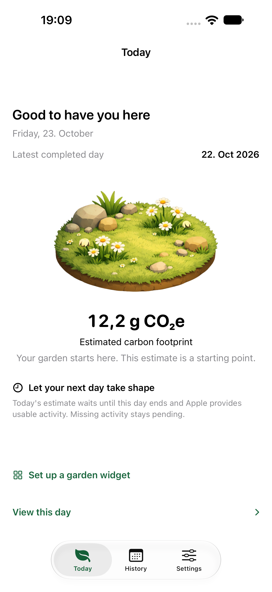

# Digital Footprint Explorer

A small garden to help you understand your phone habits.

Digital Footprint Explorer (DFE) connects everyday phone use with an estimated carbon footprint. The native iPhone app uses the same Kotlin calculation model as the Android app, then presents each completed day through a garden, clear explanations and practical suggestions.

**App usage time comes from Screen Time when Apple makes it available. Carbon emissions, data traffic and power use remain estimates.** The garden shows changes in those estimates; it does not measure changes in the environment.

## A look inside

<table>
  <tr><th>Today</th><th>History</th><th>Settings</th></tr>
  <tr>
    <td><a href="assets/readme/ios-today.png"></a></td>
    <td><a href="assets/readme/ios-history.png"></a></td>
    <td><a href="assets/readme/ios-settings.png"></a></td>
  </tr>
</table>

These simulator screens use made-up example history, with no personal activity. Open an image to see it at full size.

## What the app offers

- **A welcoming start.** A short introduction explains automatic estimates before asking for Screen Time permission. There is no account, garden name, daily form or app-by-app selection to complete.
- **A garden that follows your estimates.** Five states, from flourishing to withered, compare a completed day with the average of up to seven earlier days. The first result is a starting point, rather than a claim of improvement.
- **A clear daily picture.** Today shows the latest completed date, garden and CO₂e estimate. Expand the explanation to see app use, screen and background contributions, with category symbols and device, network and server estimates.
- **Usage you can compare.** Category colours move from green through amber to red according to time spent relative to the most-used category that day. These colours do not define a safe amount of screen time.
- **History with a next step.** Saved days keep their original inputs and results. Suggestions follow the latest suitable category estimate, with ideas such as turning off autoplay, quieting unnecessary alerts or choosing a stopping point.
- **Your garden on the Home Screen.** Small and medium widgets show the latest saved garden, estimate and date. Tapping either opens Today. Built-in guidance explains how to add them; iOS controls placement and update timing.
- **An optional morning moment.** Local notifications aim for around 08:00 in the person's time zone, after a usable estimate is ready. At most one garden notice is planned per local day; missing activity stays quiet. Tapping a notice opens Today.
- **One look across the app.** Light, Dark and System themes apply across tabs and detail views. Light uses a white background. Native Liquid Glass controls and confirmations follow iOS, while app icons have separate light and dark versions selected by the Home Screen appearance.
- **Refresh when you need it.** Pull down in Today, History or Settings to check for newer available activity. Completed-day dates remain visible, so an older result is not presented as today's data.
- **Readable, accessible controls.** Larger text, VoiceOver labels, readable status messages and generous touch areas are supported. Connection state uses words and symbols as well as colour.
- **Clear control over your data.** Settings shows the connection, notification preference, theme and offline privacy policy. Disconnecting pauses imports and keeps saved days. Deleting entries has a separate system confirmation and clears local history and setup; it does not delete Apple's Screen Time records.

## How automatic input works

After the person grants usable Screen Time access, DFE saves the all-activity setup and imports completed-day app durations. Local category rules group known apps; unmatched apps stay under **Other apps**. The user does not need to select individual apps or enter daily values.

Those durations feed the shared calculation. Traffic rates, Wi-Fi share, brightness and background activity use clearly described starting assumptions. The app does not directly measure energy use or carbon emissions. Unavailable or incomplete activity stays pending, rather than becoming a made-up result.

Imports can run when the app opens, during a manual refresh and when iOS permits background work. The app saves a small summary for its widgets. **An exact daily background update or 08:00 notification is not guaranteed:** iOS scheduling, notification settings and available data affect delivery. Natural daily delivery still needs release acceptance on the final customer build.

The expanded data route requires **iOS 26.4 or later**, the signed **Family Controls** and **App and Website Usage** entitlements, and the person's expanded authorization. The app and widget also need the same **App Group**; the widget itself needs no Screen Time entitlement. Only one app can hold Apple's expanded data authorization at a time.

Apple's published customer conditions require an EU device location and an Apple Account set to an EU country or region. Swiss development testing does not establish Swiss App Store customer access. Distribution approval alone does not remove these conditions. See [Apple's entitlement guidance](https://developer.apple.com/documentation/familycontrols/requesting-the-family-controls-entitlement) and [expanded authorization conditions](https://developer.apple.com/documentation/familycontrols/authorizationstatus/approvedwithdataaccess).

## Privacy

Activity and calculations stay on the iPhone. DFE has no usage-data server or advertising tracker, and it does not read messages, contacts, browsing content or location. Only the saved garden summary is shared locally with the widget. History that contains Screen Time data cannot be exported.

Notification access is optional and separate from Screen Time. The person can turn notices off or disconnect Screen Time in Settings. The offline policy remains available before authorization and afterwards. Privacy and support questions go to the **DFE Team**.

## Build and run

The checked development setup uses **Xcode 27.1**, an installed iOS simulator and **JDK 17**. The native app uses SwiftUI and WidgetKit, with Kotlin Multiplatform for the calculation model. It saves daily records in a local archive. The Android reference uses the shared SQLDelight database layer.

1. Clone this repository and open `apps/ios/iosApp.xcodeproj`.
2. Choose the **iosApp-ScreenTime** scheme and an available iPhone simulator. Simulator builds need no Apple signing credentials; real Screen Time activity requires an authorized physical device.
3. For a device build, copy `apps/ios/Configuration/Local.xcconfig.example` to `Local.xcconfig` in the same folder. Set the approved team, Bundle ID and App Group. Register matching app and widget identifiers and use profiles with the required capabilities. The local file is ignored by Git.
4. Build and run. On a supported device and account, enable automatic estimates and approve Apple's request. Missing access stays pending; no daily input form is required.

The repository keeps each app separate, with one shared model and one Gradle build at the root:

```text
.
├── apps/
│   ├── ios/
│   │   ├── iosApp.xcodeproj/       # Xcode project and shared schemes
│   │   ├── iosApp/                # SwiftUI screens, app startup and local storage
│   │   ├── GardenWidget/          # WidgetKit extension
│   │   ├── WidgetShared/          # Garden presentation and saved widget summary
│   │   ├── Configuration/         # Capabilities, policy text and signing example
│   │   ├── iosAppTests/           # Model, storage, refresh and notification tests
│   │   └── iosAppUITests/         # Navigation, layout and accessibility checks
│   └── android/
│       └── src/                   # Existing Android app, worker and widget
├── shared/
│   └── src/
│       ├── commonMain/            # Calculation model and SQLDelight schema
│       ├── commonTest/            # Shared model tests
│       ├── iosMain/               # iOS database driver
│       └── androidMain/           # Android database driver
├── gradle/
│   ├── libs.versions.toml         # Dependency versions
│   └── wrapper/                  # Reproducible Gradle launcher
├── scripts/                      # Build, policy and release checks
├── tests/                        # Python checks for those tools
├── assets/readme/                # Demonstration screens shown above
├── docs/                         # Existing public website, kept in its Pages location
│   ├── index.html
│   ├── dfe-sensitivity-analyser/
│   ├── images/
│   └── architecture/             # Original Android reference diagrams
├── build.gradle.kts              # Shared Gradle plugin setup
├── settings.gradle.kts           # App and shared-module locations
├── gradle.properties             # Common build options
├── gradlew                       # macOS/Linux launcher
├── gradlew.bat                   # Windows launcher
├── LICENSE
└── README.md
```

Gradle keeps the existing `:shared` and `:digitalFootprintExplorer-android` module names, even though the Android files now live in `apps/android`. Android builds also require the Android SDK selected by the version catalog.

Personal signing keys, certificates, device profiles and generated build results stay outside Git.

### Run the checks

From the repository root:

```sh
python3 -m unittest discover -s tests -v
python3 scripts/generate_privacy_policy.py --check
./gradlew :shared:iosSimulatorArm64Test
xcodebuild -project apps/ios/iosApp.xcodeproj -scheme iosApp-ScreenTime \
  -configuration ScreenTimeDebug -destination 'platform=iOS Simulator,name=iPhone 18 Pro Max' \
  CODE_SIGNING_ALLOWED=NO -only-testing:iosAppTests \
  -skip-testing:iosAppTests/LiveScreenTimeImportTests \
  -skip-testing:iosAppTests/LiveAllActivityImportTests test
```

Choose an installed simulator name. The two live import cases need a separate physical-device run with consent. Shared model tests do not replace Android app tests or customer-build acceptance.

Edit the offline policy in `apps/ios/Configuration/PrivacyPolicyContent.json`, then run `python3 scripts/generate_privacy_policy.py`. The default updates only the app copy. Separate website export is available through `--include-web`.

## Android and release status

The Android app is available on [Google Play](https://play.google.com/store/apps/details?id=ch.zhaw.digitalfootprintexplorer&hl=en).

The native iOS work is under review. App Store distribution still needs an approved signing route, a validated signed archive, public privacy/support pages, confirmed customer regions and final device acceptance. Building the app or approving an entitlement does not complete those steps.

## Contributing and licence

Developed at the **Zurich University of Applied Sciences (ZHAW)**. Existing copyright notices remain in the source files, and the project is licensed under **GNU AGPL-3.0**; see [LICENSE](LICENSE).

Changes are welcome through a branch and pull request. Include a clear description, suitable tests and any known limits. Keep personal data, credentials and local build files out of the contribution.
