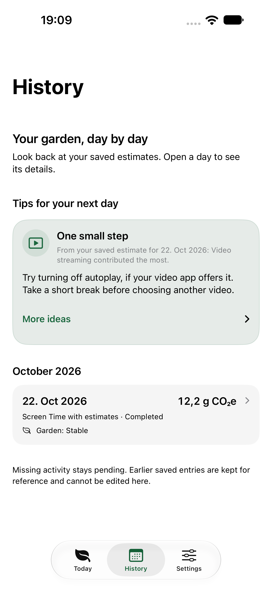
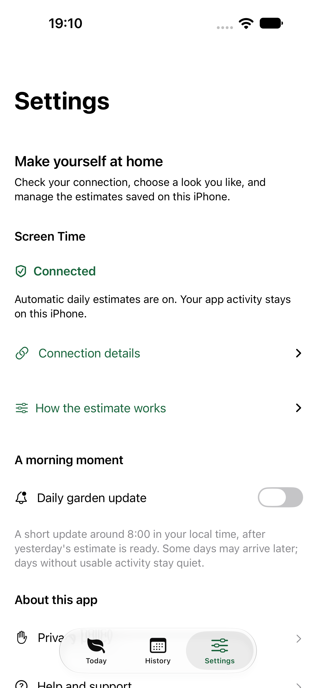

# Digital Footprint Explorer

A daily garden to help you understand your phone habits.

Digital Footprint Explorer (DFE) is a mobile application developed at the Zurich University of Applied Sciences (ZHAW). It connects everyday phone use with an estimated carbon footprint. The native iPhone app and the Android app share the same Kotlin calculation model, while each has its own interface and platform integrations.

**Screen Time provides available app usage time on iOS. Carbon emissions, data traffic and power use remain estimates.** The garden reflects those estimates; it does not measure changes in the environment.

This branch, `proposal/repository-layout`, keeps the current app in an alternative folder layout. [PR #15](https://github.com/ZHAW-InIT-SoftwareEngineering/digital-footprint-explorer/pull/15) contains the final app, calculation-test corrections and public privacy/support pages in the original repository structure. Both versions keep the same app design, functions and shared calculation model. This branch provides a folder comparison and does not need another pull request.

## A look inside

<table>
  <tr><th>Today</th><th>History</th><th>Settings</th></tr>
  <tr>
    <td><a href="apps/ios/docs/images/ios-today.png"></a></td>
    <td><a href="apps/ios/docs/images/ios-history.png"></a></td>
    <td><a href="apps/ios/docs/images/ios-settings.png"></a></td>
  </tr>
</table>

These simulator previews use isolated example history, with no personal activity. Open an image to see it at full size.

## What the iPhone app offers

- **Automatic setup.** A short introduction explains the estimates before asking for Screen Time access. There is no DFE account, garden name, daily form or app-by-app selection to complete.
- **A garden that follows the estimate.** Five garden states compare a completed day with up to seven earlier days. The first result provides a starting point, rather than claiming an improvement without a comparison.
- **A clear daily picture.** Today shows the latest completed date, garden and CO₂e estimate. The explanation includes app categories, screen and background contributions, plus device, network and server estimates.
- **Useful history and suggestions.** Saved days keep their original inputs and results. Tips suggest practical changes, such as turning off autoplay or choosing a stopping point, based on the available category estimates.
- **Small and medium garden widgets.** Both show the latest saved garden, estimate and date. Tapping a widget opens Today. The app explains how to add them; iOS controls their placement and refresh timing.
- **Optional morning updates.** Local notifications aim for around 08:00 in the user's time zone, after a usable estimate is available. The app plans at most one garden notice per local day. Tapping it opens Today.
- **Consistent appearance.** Light, Dark and System themes apply across tabs and detail views. Light uses a white background. Native Liquid Glass controls follow iOS, and the app includes separate light and dark Home Screen icons.
- **Refresh across all tabs.** Pull down in Today, History or Settings to check for newer available activity. The completed date stays visible, so an older result is not presented as today's data.
- **Accessible controls.** The interface supports larger text and VoiceOver. Connection state uses words and symbols as well as colour, and destructive actions have separate native confirmations.
- **Local data controls.** Disconnecting Screen Time pauses imports and keeps saved days. Deleting entries clears local history and setup; it does not delete Apple's Screen Time records.

## How automatic input works

After the user grants usable Screen Time access, DFE saves the all-activity setup and imports app durations for completed days. Local rules group known apps into categories. Unmatched apps remain under **Other apps**, so the user does not need to choose or classify individual apps.

The shared model uses those durations to calculate an estimate. Traffic rates, Wi-Fi share, brightness, GPS and Bluetooth use described starting assumptions. The app does not read these values from other apps or directly measure their carbon emissions. Missing or incomplete activity stays pending instead of becoming a made-up result.

Imports can run when the app opens, during a manual refresh and when iOS permits background work. The app then saves a small summary for its widgets. Exact background timing and an 08:00 notification are not guaranteed: iOS scheduling, available activity and notification settings affect delivery.

The expanded Screen Time route requires iOS 26.4 or later, the correct signed Family Controls and App and Website Usage capabilities, and the user's authorization. The app and widget share an App Group; the widget itself needs no Screen Time entitlement. Development access does not prove App Store customer availability in every country. See the [iOS guide](apps/ios/README.md#automatic-estimates-and-privacy) for Apple's access conditions and the remaining release checks.

## Privacy

Activity and calculations stay on the iPhone. DFE has no usage-upload service, advertising tracker or remote push server. It does not read message content, contacts or browsing content. Only the saved garden summary is shared locally with the widget, and history containing Screen Time data cannot be exported.

Notification permission is optional and separate from Screen Time. Settings provides the offline privacy policy, connection controls, notification preference and appearance choices. DFE Team is responsible for privacy and support, with [Ettore Ferranti](mailto:feaa@zhaw.ch) as the contact. The [privacy policy](docs/privacy-policy.html) and [support page](docs/support-ios.html) are included in the final PR #15. Their HTTPS addresses are configured in the app; verify the GitHub Pages deployment after merge and before release.

## Repository layout

The apps have separate folders, with one shared model and one Gradle build at the repository root. Android and shared module names stay the same, so existing Gradle task names still apply.

```text
.
├── apps/
│   ├── android/                     # Existing Android app, worker and widget
│   │   ├── src/androidMain/
│   │   └── build.gradle.kts
│   ├── ios/
│   │   ├── Configuration/           # Capabilities, policy source and signing example
│   │   ├── iosApp.xcodeproj/        # Xcode project and shared schemes
│   │   ├── iosApp/                  # SwiftUI screens, startup and local storage
│   │   ├── GardenWidget/            # Small and medium WidgetKit layouts
│   │   ├── WidgetShared/            # Garden states and the saved widget summary
│   │   ├── iosAppTests/             # Model, storage, refresh and notification tests
│   │   ├── iosAppUITests/           # Navigation, layout and accessibility checks
│   │   ├── scripts/                 # iOS build, policy and release checks
│   │   ├── tests/                   # Python tests for those local tools
│   │   ├── docs/images/             # Interface previews shown above
│   │   └── README.md                # Detailed iOS setup and test commands
│   └── README.md                    # App entry points and build commands
├── shared/
│   ├── src/commonMain/              # Shared model, iOS bridge and SQLDelight schema
│   ├── src/commonTest/              # Calculation and iOS bridge tests
│   ├── src/iosMain/                 # Original iOS database driver
│   ├── src/androidMain/             # Original Android database driver
│   └── build.gradle.kts
├── gradle/
│   ├── libs.versions.toml           # Dependency versions
│   └── wrapper/                     # Gradle launcher files
├── docs/                            # Existing website in its GitHub Pages location
│   ├── index.html
│   ├── ios-pages.css
│   ├── privacy-policy.html
│   ├── privacy-policy.md
│   ├── privacy-policy-content.json
│   ├── support-ios.html
│   ├── dfe-sensitivity-analyser/
│   ├── images/
│   └── architecture/                # Original reference diagrams
├── report/                          # Inherited report sources and backups
├── build.gradle.kts                 # Shared Gradle plugin setup
├── settings.gradle.kts              # Module names and folder locations
├── gradle.properties                # Shared build options
├── gradlew                          # macOS/Linux launcher
├── gradlew.bat                      # Windows launcher
├── LICENSE
└── README.md
```

Personal signing files, generated builds and test results stay outside the tracked source.

## Build and run

### iPhone app

Use a Mac with Xcode, an iOS 26.4 or later SDK, JDK 17 and an installed iPhone simulator. The Xcode build runs the root Gradle wrapper to build the shared Kotlin framework.

1. Open `apps/ios/iosApp.xcodeproj`.
2. Select the **iosApp-ScreenTime** scheme and an available iPhone simulator, then run. Simulator builds need no Apple signing credentials and cannot prove real Screen Time access.
3. For a device build, copy `apps/ios/Configuration/Local.xcconfig.example` to `Local.xcconfig` in that folder. Use your approved team, matching app/widget identifiers, App Group and provisioning profiles. Keep this local file out of Git.
4. On a supported device and account, choose **Enable automatic estimates** and approve Apple's request. A completed day stays pending until usable activity is available.

The [iOS guide](apps/ios/README.md) covers signing, automatic input, policy generation and release checks.

### Android app

The Android app is available on [Google Play](https://play.google.com/store/apps/details?id=ch.zhaw.digitalfootprintexplorer&hl=en).

For development, open the repository root in Android Studio and install the SDK required by the version catalog. Build the existing module from the root:

```sh
./gradlew :digitalFootprintExplorer-android:assembleDebug
```

On Windows, use `gradlew.bat` instead. The Android source is moved to `apps/android/` without changing its behaviour; the module still uses the original shared database and calculation model.

## Run the checks

From the repository root:

```sh
python3 -m unittest discover -s apps/ios/tests -v
python3 apps/ios/scripts/generate_privacy_policy.py --check
python3 apps/ios/scripts/generate_privacy_policy.py --check --include-web
bash apps/ios/scripts/ios-check.sh
```

The last command runs all 24 shared calculation tests and the controlled native unit tests. The corrected time-unit fixtures and the iOS bridge tests run together, as in the final PR #15. Set `DFE_SIMULATOR_ID` to use a particular installed simulator. The tool writes its `.xcresult` bundle outside the repository by default and prints the location.

The [iOS guide](apps/ios/README.md#run-the-checks) also gives the interface-test command and explains which checks need a physical device. Controlled tests use isolated stores and do not request personal Screen Time access. They do not replace Android app testing or final customer-build acceptance.

## Release status

The iOS app remains under review. App Store distribution still needs a validated signed build, published and verified privacy/support pages, confirmed customer regions and physical-device acceptance of daily background updates, visible widget refresh and notification delivery. Compilation and simulator results do not establish those results.

## Contributing and licence

Developed at the **Zurich University of Applied Sciences (ZHAW)**. The project uses **GNU AGPL-3.0**; see [LICENSE](LICENSE). Existing copyright notices remain in the source files.

Propose changes through a branch and pull request. Explain the change, include suitable test output and describe any known limits. Keep personal data, signing credentials and local build results out of the contribution.
